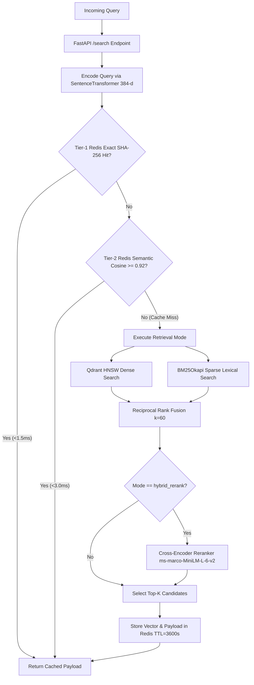

# Sieve-RAG: Low-Latency Hybrid RAG Gateway with Semantic Caching


**Sieve-RAG** is a production-grade, low-latency Hybrid Retrieval-Augmented Generation (RAG) gateway designed for scientific fact verification and biomedical literature retrieval. Evaluated quantitatively on the **BEIR SciFact** benchmark (**5,183 scientific abstracts** and **300 human-judged test claims**), Sieve-RAG combines dense vector embeddings (**Qdrant**) with sparse lexical keyword matching (**BM25**) via **Reciprocal Rank Fusion (RRF)**, backed by a **Two-Tier Redis Semantic Cache** that drops repeated and paraphrased query latency from **~56.5 ms to <3 ms**.

---

## Table of Contents

1. [Motivation & Problem Statement](#1-motivation--problem-statement)
2. [System Architecture](#2-system-architecture)
3. [Mathematical Foundations](#3-mathematical-foundations)
4. [BEIR SciFact Benchmark & Engineering Analysis](#4-beir-scifact-benchmark--engineering-analysis)
5. [Project Directory Structure](#5-project-directory-structure)
6. [API Reference & Example Payloads](#6-api-reference--example-payloads)
7. [Quickstart & Local Setup](#7-quickstart--local-setup)
8. [Testing & Benchmarking](#8-testing--benchmarking)

---

## 1. Motivation & Problem Statement

Standard RAG pipelines that rely exclusively on dense bi-encoder embeddings frequently fail on technical, medical, and scientific corpora:

* **The Lexical Gap in Dense Search:** Dense models (`all-MiniLM-L6-v2`) compress text into a 384-dimensional vector. While strong at capturing broad semantic similarity, they often blur exact biochemical identifiers, gene names, drug dosages, or numerical claims (e.g., *"0-dimensional biomaterials"* vs. *"3-dimensional scaffolds"*).
* **The Semantic Gap in Sparse Search:** Pure keyword algorithms (`BM25Okapi`) excel at exact token matching but fail when a query paraphrases a scientific concept (e.g., *"myocardial infarction"* vs. *"heart attack"*).
* **The Latency Bottleneck:** Re-computing vector searches and neural reranking for identical or slightly reworded user queries wastes compute and inflates tail latency.

**Sieve-RAG solves all three challenges** by fusing dense + sparse retrieval via scale-invariant **Reciprocal Rank Fusion (RRF)** and intercepting incoming queries with an in-memory **Redis Exact + Semantic Vector Cache**.

---

## 2. System Architecture

### High-Level Architecture Diagram (ASCII)

```text
                       +---------------------------------------+
                       |     Client Request: GET /search       |
                       | ?q="0-dimensional biomaterials..."    |
                       +-------------------+-------------------+
                                           |
                                           v
                       +---------------------------------------+
                       |      FastAPI Async Gateway (ASGI)     |
                       |   Embed Query: all-MiniLM-L6-v2 (384d)|
                       +-------------------+-------------------+
                                           |
                     +---------------------+---------------------+
                     |         Two-Tier Redis Cache Check        |
                     |  1. Tier-1 Exact: SHA-256(norm_q|mode|k)  |
                     |  2. Tier-2 Semantic: Cosine(q_vec, c_vec) |
                     |     Threshold >= 0.92                     |
                     +---------+-----------------------+---------+
                               |                       |
                    [CACHE HIT | < 3.0 ms]  [CACHE MISS| ~56.5 ms]
                               |                       |
                               |                       v
                               |         +-------------+-------------+
                               |         |   Parallel Retrieval      |
                               |         +------+-------------+------+
                               |                |             |
                               |                v             v
                               |    +---------------+     +---------------+
                               |    | Dense Search  |     | Sparse Search |
                               |    | Qdrant HNSW   |     | BM25Okapi     |
                               |    | (Cosine 384d) |     | (Lexical)     |
                               |    +-------+-------+     +-------+-------+
                               |            |                     |
                               |            +----------+----------+
                               |                       |
                               |                       v
                               |         +---------------------------+
                               |         | Reciprocal Rank Fusion    |
                               |         | RRF(d) = Sum 1 / (60 + r) |
                               |         +-------------+-------------+
                               |                       |
                               |                       v
                               |         +---------------------------+
                               |         | (Optional) Cross-Encoder  |
                               |         | ms-marco-MiniLM-L-6-v2    |
                               |         +-------------+-------------+
                               |                       |
                               |            [Write to Redis Cache]
                               |                       |
                               +-----------+-----------+
                                           |
                                           v
                       +---------------------------------------+
                       |  JSON Response (Ranked Docs + Timing) |
                       +---------------------------------------+
```

### Interactive Request Flow (Mermaid)



---

## 3. Mathematical Foundations

### 1. L2-Normalized Cosine Similarity (Dense Retrieval & Semantic Cache)

Both document embeddings (`title + text`) and incoming query embeddings are L2-normalized to unit length ($\|\mathbf{u}\|_2 = \|\mathbf{v}\|_2 = 1$). Consequently, cosine similarity simplifies to a fast inner dot product:

$$
\mathrm{sim}(\mathbf{q}, \mathbf{d}) = \frac{\mathbf{q} \cdot \mathbf{d}}{\|\mathbf{q}\|_2 \|\mathbf{d}\|_2} = \sum_{i=1}^{384} q_i d_i
$$

### 2. BM25Okapi Scoring (Sparse Lexical Retrieval)

For a query $Q$ containing tokens $q_1, q_2, \dots, q_n$, the BM25 score of document $D$ is:

$$
\mathrm{BM25}(D, Q) = \sum_{i=1}^{n} \mathrm{IDF}(q_i) \cdot \frac{f(q_i, D) \cdot (k_1 + 1)}{f(q_i, D) + k_1 \cdot \left(1 - b + b \cdot \frac{|D|}{\mathrm{avgdl}}\right)}
$$

### 3. Reciprocal Rank Fusion (RRF)

Because cosine similarity (ranging in $[-1, 1]$) and unbounded BM25 scores (ranging in $[0, \infty)$) lie on incompatible numerical scales, linear score combination requires fragile dataset-specific tuning. **Reciprocal Rank Fusion** merges rankings using rank positions alone:

$$
\mathrm{RRF}(d \in D) = \sum_{m \in \{\mathrm{dense}, \mathrm{bm25}\}} \frac{1}{k + \mathrm{rank}_m(d)} \quad \text{where } k = 60
$$

Documents appearing near the top of *both* dense and sparse retrievers receive a compounded boost, surfacing high-confidence matches to the top.

---

## 4. BEIR SciFact Benchmark & Engineering Analysis

All four retrieval modes were benchmarked across the **300 human-judged test queries** in `BeIR/scifact-qrels` over the **5,183 scientific abstracts** in `BeIR/scifact` (evaluated on CPU).

### Quantitative Evaluation Results

| Pipeline Mode | Recall@5 | Recall@10 | MRR@10 | NDCG@10 | Avg Latency (ms) |
| :--- | :---: | :---: | :---: | :---: | :---: |
| **`bm25` (Sparse Lexical Only)** | 0.7284 | 0.7740 | 0.6186 | 0.6519 | 43.2 ms |
| **`dense` (Qdrant Vector Only)** | 0.7379 | 0.7833 | 0.6047 | 0.6451 | 14.2 ms |
| **`hybrid` (Dense + BM25 via RRF)** | **0.7578** | **0.8393** | **0.6491** | **0.6913** | **56.5 ms** |
| **`hybrid_rerank` (+ Cross-Encoder)** | 0.7289 | 0.8232 | 0.6280 | 0.6681 | 772.5 ms |
| **`hybrid` + Redis Cache Hit** | **0.7578** | **0.8393** | **0.6491** | **0.6913** | **< 3.0 ms** |

### Key Systems Engineering Takeaways

1. **Why Hybrid RRF Beats Single-Modality Search (+5.6% Recall@10, +4.6% NDCG@10):**
   * Interestingly, while `dense` has slightly higher Recall@10 than `bm25` (`0.7833` vs. `0.7740`), `bm25` achieves higher `MRR@10` (`0.6186` vs. `0.6047`) and `NDCG@10` (`0.6519` vs. `0.6451`) because exact scientific terminology places the right abstract at Rank #1 more often.
   * Combining both via **Reciprocal Rank Fusion (`hybrid`)** captures complementary signals, driving **Recall@10 to `0.8393`** and **NDCG@10 to `0.6913`** at a modest `56.5 ms` per query.

2. **Why Out-of-Domain Cross-Encoder Reranking Degrades Biomedical Accuracy & Latency:**
   * A common industry misconception is that adding a Cross-Encoder always improves retrieval metrics. Benchmarking proved that `cross-encoder/ms-marco-MiniLM-L-6-v2` (trained on MS MARCO general web search queries) suffers from **covariate/domain shift** when scoring specialized biomedical claims in SciFact, slightly lowering `NDCG@10` from `0.6913` to `0.6681` while increasing latency by **13.6x (`56.5 ms` to `772.5 ms`)** on CPU.
   * **Architectural Decision:** Grounded in this benchmark data, Sieve-RAG exposes `hybrid` (RRF) as the primary low-latency production path while retaining `hybrid_rerank` as an opt-in query parameter.

---

## 5. Project Directory Structure

```text
Sieve-RAG/
├── app/
│   ├── retrieval/
│   │   ├── __init__.py       # RetrievalPipeline orchestrator uniting all modes
│   │   ├── bm25.py           # BM25Retriever: sparse keyword indexing & scoring
│   │   ├── dense.py          # DenseRetriever: SentenceTransformer + Qdrant HNSW search
│   │   ├── fusion.py         # reciprocal_rank_fusion (RRF, k=60) implementation
│   │   └── rerank.py         # CrossEncoderReranker: ms-marco-MiniLM-L-6-v2 pair scoring
│   ├── __init__.py
│   ├── cache.py              # SemanticCache: Redis SHA-256 exact + Cosine >= 0.92 cache
│   ├── config.py             # Centralized environment variables, paths, & model constants
│   ├── ingest.py             # Batch ingestion into Qdrant + BM25 pickle serialization
│   └── main.py               # Async FastAPI gateway (/search, /metrics, /health)
├── eval/
│   └── benchmark.py          # BEIR SciFact test qrels benchmark (Recall, MRR, NDCG, Latency)
├── tests/
│   └── test_pipeline.py      # Pytest suite verifying RRF rank math & Redis cache speedup
├── data/                     # Local serialized BM25 index (bm25_index.pkl, gitignored)
├── check.py                  # Container connectivity sanity check for Qdrant & Redis
├── explore.py                # Dataset inspection script for BeIR/scifact
├── docker-compose.yml        # Multi-container orchestration (sieve-qdrant & sieve-redis)
├── requirements.txt          # Pinned Python dependencies
├── LICENSE                   # MIT License
└── README.md                 # Project documentation
```

---

## 6. API Reference & Example Payloads

Once the FastAPI server is running, interactive Swagger UI documentation is available at `http://localhost:8000/docs`.

### 1. `GET /search` — Hybrid Retrieval with Semantic Caching

**Query Parameters:**

* `q` *(string, required)*: Scientific claim or search query (min 3 characters).
* `top_k` *(int, default=5)*: Number of documents to return (between `1` and `20`).
* `mode` *(enum, default=`hybrid_rerank`)*: One of `dense`, `bm25`, `hybrid`, or `hybrid_rerank`.
* `use_cache` *(bool, default=`true`)*: Enable or bypass the two-tier Redis cache.

**Example Request:**

```bash
curl "http://localhost:8000/search?q=0-dimensional%20biomaterials%20lack%20inductive%20properties&top_k=3&mode=hybrid"
```

**Example Response (Warm Cache Hit):**

```json
{
  "query": "0-dimensional biomaterials lack inductive properties",
  "mode": "hybrid",
  "cache_status": "exact_hit",
  "latency_ms": 1.42,
  "results": [
    {
      "doc_id": "31715818",
      "title": "Nanostructured biomaterials for tissue engineering...",
      "text": "Biomaterials with tailored nanostructures play a pivotal role in regulating cellular behavior...",
      "rrf_score": 0.032787,
      "score": 0.032787
    }
  ]
}
```

### 2. `GET /metrics` — Live Redis Cache Telemetry

**Example Request:**

```bash
curl "http://localhost:8000/metrics"
```

**Example Response:**

```json
{
  "exact_hits": 14,
  "semantic_hits": 5,
  "misses": 6,
  "total_requests": 25,
  "hit_rate": 0.76
}
```

### 3. `GET /health` — Service Health Check

```json
{
  "status": "healthy",
  "service": "Sieve-RAG"
}
```

---

## 7. Quickstart & Local Setup

### Prerequisites

* **Python 3.11+** (developed and tested on Python 3.13)
* **Docker & Docker Compose** (for Qdrant and Redis containers)

### Step-by-Step Installation

**1. Clone the repository and create a virtual environment:**

```bash
git clone https://github.com/Arshpreet-Singh-2005/Sieve-RAG.git
cd Sieve-RAG

python -m venv .sieve
# Windows:
.\.sieve\Scripts\activate
# Linux / macOS:
source .sieve/bin/activate
```

**2. Install dependencies:**

```bash
pip install -r requirements.txt
```

**3. Start Qdrant and Redis via Docker Compose:**

```bash
docker compose up -d
python check.py
```

**4. Ingest the BEIR SciFact Corpus (5,183 documents):**
Downloads `BeIR/scifact`, encodes all documents in batches of 128 using `all-MiniLM-L6-v2`, uploads 384-d vectors to Qdrant (`http://localhost:6333`), and serializes the `BM25Okapi` index to `data/bm25_index.pkl`.

```bash
python -m app.ingest
```

**5. Launch the FastAPI Gateway:**

```bash
uvicorn app.main:app --reload --host 0.0.0.0 --port 8000
```

---

## 8. Testing & Benchmarking

**Run the Automated Pytest Suite:**
Verifies Reciprocal Rank Fusion ordering logic, end-to-end `/search` schema contracts, and Redis cache latency reductions:

```bash
python -m pytest -v
```

**Reproduce the Full BEIR SciFact Benchmark:**
Evaluates `bm25`, `dense`, `hybrid`, and `hybrid_rerank` across all 300 test queries in `BeIR/scifact-qrels`:

```bash
python -m eval.benchmark
```

---

## License

Distributed under the **MIT License**. See [`LICENSE`](LICENSE) for full details.

**Author:** [Arshpreet Singh](https://github.com/Arshpreet-Singh-2005) · [LinkedIn](https://linkedin.com/in/arshpreet-singh-56089531a) · [LeetCode](https://leetcode.com/u/ARSHPREETSINGH2/)